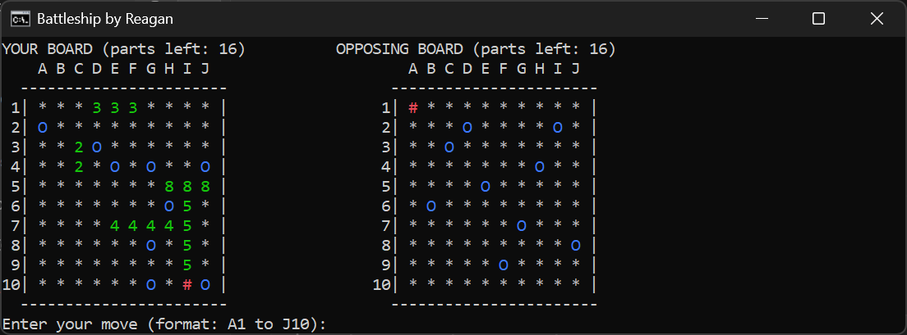

# Battleship Console Game

A single-player Battleship game for the Windows console, written in C. You play against the computer on two 10×10 boards, with colored output for hits, misses and sunk ships.



## Features
- Two 10×10 boards (yours and the opponent's), with the opponent's ships hidden
- Five ships placed randomly for both sides:

  | Ship | Length |
  |---|---|
  | 5-parts ship | 5 |
  | 4-parts ship | 4 |
  | Alpha 3-parts ship | 3 |
  | Beta 3-parts ship | 3 |
  | 2-parts ship | 2 |
- Hit, miss and "ship sunk" messages in color
- Repeated shots on the same cell are detected
- The game ends when either side loses all 17 ship parts

## Board symbols
| Symbol | Meaning |
|---|---|
| `*` | Water (untouched) |
| `#` | Hit |
| `O` | Miss |
| `2`–`5`, `8` | Your ship parts |

## Build and run
The project file is for Code::Blocks (`Battleship by Reagan.cbp`). You can also build it with GCC (MinGW):

```bash
gcc main.c -o battleship.exe
battleship.exe
```

> It uses `windows.h` for console colors, so it runs on Windows only.

## Files
- `main.c`: the game
- `bug check.c`: an earlier draft kept for reference (it doesn't compile)

## License
Released under the [MIT License](LICENSE).
